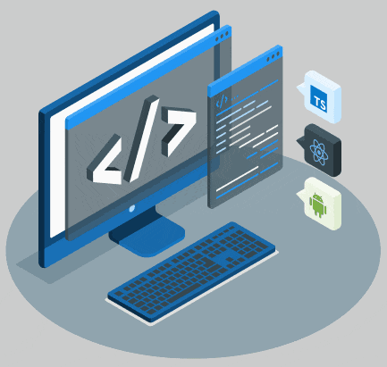

<!--
  GitHub Profile README — tlmee
  https://github.com/tlmee
-->

<div align="center">

  

  <br /><br />

  <h1>Hussein Makkiya</h1>

  <p>
    <b>Backend · SaaS · Systems Developer</b>
  </p>

  <p>
    Building reliable platforms, clean APIs, and automation that scales.<br />
    <i>Build systems — not scripts.</i>
  </p>

  <p>
    <a href="https://github.com/tlmee">
      
    </a>
    
    
  </p>

</div>

---

## About

I design and ship backend systems and SaaS products — from API foundations to deployment and automation. I care about clarity, reliability, and code that stays maintainable as the product grows.

| | |
|:--|:--|
| **Role** | Backend & Systems Developer |
| **Focus** | SaaS platforms · APIs · automation |
| **Approach** | Systems over scripts · ship with intent |

---

## Stack

<p align="center">
  
</p>

<p align="center">
  
  
  
  
  
  
  
  
</p>

---

## Focus

```text
┌─────────────────────┬─────────────────────┐
│  Backend Systems    │  SaaS Platforms     │
│  API Development    │  Automation Tools   │
└─────────────────────┴─────────────────────┘
```

- **Backend Systems** — services, data flow, and reliability under load  
- **SaaS Platforms** — multi-tenant product structure and shipping loops  
- **API Development** — clear contracts, auth, and developer-friendly design  
- **Automation Tools** — remove repetitive work with scripts and pipelines  

---

## Activity

<p align="center">
  
  
</p>

<p align="center">
  
</p>

<p align="center">
  
</p>

---

## Connect

<p align="center">
  <a href="https://github.com/tlmee">
    
  </a>
  &nbsp;
  <a href="https://x.com/">
    
  </a>
  &nbsp;
  <a href="https://linkedin.com/">
    
  </a>
</p>

---

<div align="center">

  **BUILD SYSTEMS · NOT SCRIPTS**

  <sub>Thanks for visiting — open to collaboration on backend & SaaS work.</sub>

</div>
